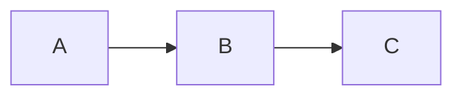

# Documentation Site

## Site purpose

- `capsem.org` answers: “Why Capsem, what can I do, and how quickly can I get value?” Marketing owns benefits, use cases, and the short path to value; see `/site-marketing`.
- `docs.capsem.org` answers: “Exactly how does this work, how do I operate/integrate/administer it, and what is the contract?” Docs owns precise procedures, behavior, configuration, interfaces, limits, and guarantees.

## Diátaxis is the authoring contract

All technical documentation must follow the principles and structure of the
[Diátaxis Framework](https://diataxis.fr/). Before drafting or reviewing a page,
identify its reader, the question it answers, and exactly one of the four
document types below. Its structure and content must serve that type.

### Guiding principles

1. **Clarity:** use simple, clear, unambiguous language. Explain necessary
   terms for the intended reader; remove internal jargon that adds no value.
2. **Accuracy:** check commands, code snippets, UI controls, defaults, limits,
   and guarantees against the current target contracts. Verify examples through
   the relevant project rails and record what was verified. Never invent output
   or present an untested example as tested.
3. **User-centricity:** identify a specific user and the task or need the page
   serves. That need may be learning a skill, solving a problem, looking up a
   fact, or understanding a topic; do not force all four into procedures.
4. **Consistency:** use consistent tone, terminology, names, units, and example
   conventions across the manual. Keep a stable structure within each type;
   do not impose the same structure on all four types.

### The four document types

| Type | Orientation and purpose | Structure |
| --- | --- | --- |
| [Tutorial](https://diataxis.fr/tutorials/) | Learning: guide a newcomer through a practical lesson to a successful outcome. | Concrete outcome and prerequisites → small ordered actions → visible results and checkpoints → completed exercise. |
| [How-to guide](https://diataxis.fr/how-to-guides/) | Problem-solving: help a competent user accomplish a specific real-world task. A recipe. | Specific goal and starting conditions → necessary actions and relevant decisions → result or completion check. |
| [Reference](https://diataxis.fr/reference/) | Information: give precise technical descriptions of the machinery. A dictionary to consult. | Predictable entries that mirror the product's interfaces, with exact facts and concise examples. |
| [Explanation](https://diataxis.fr/explanation/) | Understanding: clarify a bounded topic and its context. A discussion. | Topic or why question → concepts and relationships → rationale, constraints, implications, and relevant alternatives. |

**Tutorials:** choose a reliable path for the learner and make success visible
early and throughout. Explain only what they need for the next action; link to
deeper explanation and reference. Avoid branches, optional advanced tasks,
catalogues of alternatives, and exhaustive flags. A tutorial teaches through
doing; it is not a collection of how-tos.

**How-to guides:** start from the user's problem, not a feature tour. Assume
the reader knows the basics and wants a result. Include choices or branches
when the real task requires them, with enough guidance to choose. Omit lessons,
background discussions, and complete option lists; link to the other types.

**Reference:** describe accurately, neutrally, and completely within the
declared scope. Use consistent fields for syntax, inputs, types, defaults,
outputs, errors, constraints, and guarantees where applicable. Examples
illustrate usage; they do not become a lesson or a procedural walkthrough.
Link to guides for tasks and explanation for rationale.

**Explanation:** develop understanding of how and why things fit together.
Discuss design decisions, trade-offs, boundaries, and alternatives when useful,
distinguishing established facts from interpretation. Do not bury installation
steps, recipes, or API/CLI inventories in the discussion; link to their owners.

Keep the types distinct. A short definition, illustrative example, or link can
support a page's purpose without turning it into a second type. If substantial
material belongs to another type, use an existing approved destination or wait
for user direction; this framework does not authorize new pages or page splits.

### Applying the types to our approved sections

- `getting-started/`: newcomer tutorials for learning by doing. An installation
  procedure can be a how-to; classify by reader need, not directory name.
- `guides/`: task-specific how-to guides, written last as agreed.
- `architecture/`: explanations of architecture and the security model.
- `reference/`: CLI, MCP, API, and configuration reference.
- `sdk/`: an integration subject area, not a fifth document type. Each SDK
  page must be a tutorial, how-to, reference, or explanation with a distinct
  purpose; link between those purposes instead of mixing them.

These are the approved section names. Applying Diátaxis does not authorize
renaming them, creating more directories, filling TODOs, or adding pages.

## Content budget and user direction

Write the minimum content on the minimum number of pages needed to answer
those documentation questions completely. Prefer a section in an approved
page and links to the canonical explanation over another page or duplicated
prose. A feature, subsystem, troubleshooting case, or release does not
automatically earn a page. Keep necessary prerequisites, defaults, failure
behavior, and security limits; brevity must not make the contract ambiguous.

**New pages require explicit user approval before creation.** A general request
to improve or rebuild docs is not approval for an agent-chosen page list.
The user will tell us what to write. Do not proactively propose pages, page
lists, outlines, or documentation topics. Follow the user's supplied scope and
record page approval in the owning Sprinty item. New categories and page splits
follow the same rule. Edit approved pages within their agreed scope without
asking again.

## Rebuild from scratch

The documentation rebuild starts from reader needs and current product
contracts. The old manual is reference material, not the target information
architecture or a backlog of stubs to fill.

Capsem 0.7 is the baseline. Architecture and security pages describe the
agreed final architecture with the security refactoring complete; verify
against those contracts rather than carrying over older behavior.

1. Wait for the user to specify what to write and which pages to create or edit.
2. Keep that requested content on the fewest approved pages, using related
   sections and canonical links instead of duplicating explanations.
3. Write the requested content afresh from current code, schemas, CLI/API contracts,
   and verified behavior. Reuse old text only after checking it against those
   sources; do not carry forward historical commands or claims by default.
4. Review for completeness, duplication, and removable prose. Verify commands,
   links, and examples with the relevant project skills and bounded rails.

Approval of content or page structure does not itself authorize publication.
Preserve the holding/tombstone safeguards below until the replacement manual
and its publication are approved.

## Source and current publication state

The detailed documentation source for docs.capsem.org is authored for
[Astro Starlight](https://starlight.astro.build/) and lives in
`web/docs/src/content/docs/` as Markdown/MDX files. During the Capsem 0.6
pre-release, the production Astro build deliberately does not register the
Starlight integration: it publishes `web/docs/src/pages/index.astro` as the root
holding page and derives a noindex holding tombstone for every former detailed
route while every source file remains checked in.

## Dev workflow

Verify `/` and the header-logo link as well as changed document routes in the
rendered preview. The preview root redirects to Installation while Intro is
TODO; do not create an unapproved landing page to repair root navigation.

```bash
uv run --project build_system --frozen python build_system/scripts/ci/run-bounded-command.py --timeout-seconds 120 -- pnpm --dir web/docs run dev
uv run --project build_system --frozen python build_system/scripts/ci/run-bounded-command.py --timeout-seconds 300 -- pnpm --dir web/docs run build
```

## CI and deploy rail

`ci.yaml` runs the merge-blocking `docs-build` job under `pr-gate`. `docs.yaml`
deploys only on every push to `main` and smokes `https://docs.capsem.org/`, then
requires the warmed `/getting-started/` tombstone markers while rejecting its
old guide/install content. This deploy rail is independent from binary releases,
manual VM asset releases, and the `release.capsem.org` asset-channel workflow.

## Capsem 0.6 holding boundary

- Do not delete or rewrite the detailed manual to produce the holding page.
- `web/docs/src/pages/[...slug].astro` derives one static noindex tombstone from
  every detailed Markdown/MDX source except the root `index.mdx`. A removed
  path is not enough: Cloudflare can continue serving a warmed old asset after
  deletion, so each former URL must be replaced explicitly.
- `web/docs/public-holding/_headers` applies no-store browser/CDN policy and an
  `X-Robots-Tag` to the complete qualification surface.
- `build_system/scripts/web/check-docs-holding-build.py` independently derives the exact
  tombstone inventory from the manual sources. It permits only those files,
  the root holding page, a top-level `404.html`, and `_headers`; it rejects
  unexpected artifacts and old Starlight, installation, release, or deep-doc
  content.
- The holding page must say that 0.6 is in pre-release qualification and must
  not offer installation instructions or release downloads.
- Restoring detailed routes is a separate publication decision: register
  Starlight again only when the 0.6 documentation is approved for release.

## Writing and review

Write for the intended reader with the structure of the chosen document type.
Use BLUF: lead with the direct answer in one or two simple sentences. Avoid
abstract framing and paragraphs that repeat a diagram or table. Architecture
pages use concrete component relationships and a process/role/sandboxing table.
Keep one canonical explanation or contract and link to it instead of repeating
it. No filler, marketing pitches, or speculative features. Use tables for
comparable facts and Mermaid diagrams when they clarify relationships.

In tutorials and how-tos, explain necessary options when first used, identify
sample names and replaceable values, and say whether commands run on the
reader's computer or inside the VM. Complete the requested task: launching a
VM must lead to accessing it when the goal is to work in it. Explain `capsem suspend`
as pausing work, `capsem resume` as returning to it, and `capsem fork` as duplicating a prepared setup for
another use. Keep explanations proportional to the chosen type, with detailed
mechanics and rationale in their reference and explanation destinations.

### One thing, one name

Use the names exposed by the public command line for its concepts, commands,
and options. One thing has one name throughout prose, headings, links, and
examples; do not invent synonyms for variety. Write `image` as in `--image`
and `capsem images`, then explain what it lets the user do in simple language.
When referring to a command, include the executable and format the full name
as inline code so it stands out: `capsem fork`, `capsem suspend`,
`capsem resume`, `capsem create`, and `capsem shell`. Do not shorten command
references to bare subcommands such as `fork` or `create`.

**VM** is the environment the user creates, accesses, suspends, resumes, or
forks. Do not rename it a project, workspace, container, session, or setup.
An **image** supplies its software; a container image and a VM are distinct
things. Use **TUI** for the terminal interface and **Capsem UI** for the
graphical interface, not “UI app.” Define these interface terms at first use.
Keep exact command names and actual control labels when quoting them.

### Simplicity, links, and sequence

Keep first-use explanations short and specific to what the reader can do.
For example, explain that a name keeps a VM for stop/resume and reuse, then
link to the sections on pausing work and duplicating a setup. Explain that
`--image` selects a prebuilt or administrator-authorized custom image,
then link to image selection. Preserve these useful capabilities instead
of replacing them with vague wording such as “come back later.”

Link at the point where the reader may need more detail: to the relevant
section for the next action, to reference for exact options, or to explanation
for deeper understanding. Use descriptive link text, verify the destination,
and avoid repeating the destination's full content. Do not create a page to
supply a link without approval.

For tutorials and how-tos, make the temporal relationship between sections
explicit. State the prerequisite or trigger before an action: “Once your VM
is created…”, “When you are ready to pause…”, or “After preparing a setup…”.
Order dependent actions by when they become possible; identify choices and
optional branches as such. Distinguish work on the current VM from decisions
made before creating another VM. A heading alone does not communicate this.
Do not impose chronological steps on reference or explanation.

### Improve the skill with every documentation change

Whenever documentation changes, propose a concise, reusable improvement to
this skill based on what the change or user correction taught us. State the
proposed rule to the user alongside the work; a generic promise to improve
is not a proposal. Apply improvements the user requests or accepts and record
them in the owning Sprinty item. Keep proposals about writing rules separate
from page/topic proposals, which remain user-directed.

Generalize the lesson rather than accumulating instructions for one sentence.
If an existing rule already captures it, propose a clearer rule or a specific
review check rather than adding a duplicate. After incorporating a correction,
review the whole affected page for the same pattern, not only the cited line.

Review before delivery:

- **Every page:** does it answer its description question for its intended
  reader, use accurate and consistent terms, and stay within one type?
- **Tutorial:** can a newcomer follow the chosen path without guessing and see
  the promised result at each meaningful step? Are prerequisites, transitions,
  and links for further detail clear throughout?
- **How-to:** can the intended user solve the stated problem, including any
  necessary decisions, without being taken through an unrelated lesson? Is it
  clear when each action or branch applies and where to find deeper detail?
- **Reference:** can someone quickly find exact, complete facts for the stated
  interface or contract without searching through a narrative?
- **Explanation:** does the reader understand the topic, its relationships and
  rationale without being diverted into a recipe or interface inventory?

Fix editorial and task gaps before treating a passing build as completion.

## Frontmatter

Every doc page must include `title` and `description`. Starlight handles `lastUpdated` from git history automatically. No `layout:` field -- Starlight provides its own.

The `description` is always the reader's question that the page answers,
phrased as a direct question ending in `?`. Keep it specific to the page's
scope; do not use a summary, slogan, or imperative. Apply this rule to every
new page and whenever an existing page is rewritten.

```markdown
---
title: Page Title
description: How do I install Capsem on my computer?
sidebar:
  order: 10
---
```

## Approved pages and navigation

After approval, create the agreed Markdown/MDX path under
`web/docs/src/content/docs/` with the frontmatter above. When Starlight is
restored, configure its sidebar in `web/docs/astro.config.mjs` to match the
approved page list; `sidebar.order` controls order within a section. Do not
turn every source directory into a navigation category.

A minor release does not authorize a new release page. Use `CHANGELOG.md`
for release history and update the approved manual where behavior changed.
Create a separate release page only when the user requests and approves it.

## SDK package documentation

Keep each package's hand-written getting-started document as its `README.md`,
with **About**, **Installation**, and **Usage** sections. State what the reader
can do, required versions and service access, then give a small complete example
and explain its result. Link to guides for tasks and reference for exact API
details using absolute documentation URLs that also work on npm and PyPI.

Use one SDK getting-started page for the shared task, with Python, TypeScript,
and Rust examples in language tabs. Symlink package READMEs into the docs source
and render them in those tabs rather than copying prose or creating a page per
language. Keep real README files inside packages so packaging includes them;
site-only title and question-description metadata belong on the shared page.
Verify both docs rendering and registry/package Markdown requirements.

Keep first-use examples linear with direct `await` statements. Avoid async
function wrappers, runner boilerplate, and try/finally scaffolding in the lesson;
state the execution context and retain necessary lifecycle actions. Detailed
error handling and cleanup belong in reference or a task-specific guide.
Local onboarding should not ask users to find gateway URLs or copy tokens.
Track missing SDK ergonomics as bugs; flag dependent examples as drafts rather
than claiming they work before those bugs are fixed.
Documentation work does not authorize implementing those SDK fixes. Keep basic
examples free of connection setup; use an existing bug or file one for a missing
default. Keep explicit remote connection details in reference and integration
guides, where the reader needs them.

Link application integration to `guides/developers/integrate-the-sdk/`, VM
configuration to `guides/enterprise/configure-a-vm/`, and investigation to
`guides/enterprise/investigate-a-vm/`. Keep language API references under
`sdk/`. Inspect AI and the future UI security workflow remain explicit TODOs
until their implementations are available. Document only actual export
contracts; a body archive export is not a complete telemetry export.
Generate API reference separately from public SDK interfaces, types, and
docstrings/comments, including hand-written facades as well as generated
operations. Do not generate or overwrite the getting-started README, and do
not claim a reference exists before it is generated and accessible.

## Mermaid diagrams

The site uses `astro-mermaid` for rendering. Use fenced code blocks:

````markdown

````

## Astro reference

Read `references/astro.md` for Astro framework patterns (components, content collections, SSR, CLI). From the official Astro team.

## Theme

Custom CSS in `web/docs/src/styles/custom.css`. Accent colors and fonts. Logo at `web/docs/src/assets/logo.svg`.

## Graphics and icons

Source of truth for all icons: `web/graphics/`.

```
web/graphics/
  icon/                        Brand icon in multiple sizes and variants
    icon-mainfile.ai           Illustrator source file
    22w/                       22px (menu bar)
    1x/                        726px (standard)
    2x/                        1450px (retina)
    3x/                        2176px
    4x/                        2900px
    1024w/                     1024px (app store, high-res)
    Variants: capsem-logo-{black,color,grey,white}.png
  tauri/                       Pre-built Tauri app icon set
    32x32.png, 128x128.png, 128x128@2x.png
    icon.icns, icon.ico, icon.svg
```

Site favicons in `web/docs/public/` are generated from `web/graphics/icon/1024w/capsem-logo-color.png`. To regenerate:

```bash
sips -z 16 16 web/graphics/icon/1024w/capsem-logo-color.png --out web/docs/public/favicon-16x16.png
sips -z 32 32 web/graphics/icon/1024w/capsem-logo-color.png --out web/docs/public/favicon-32x32.png
sips -z 180 180 web/graphics/icon/1024w/capsem-logo-color.png --out web/docs/public/apple-touch-icon.png
sips -z 192 192 web/graphics/icon/1024w/capsem-logo-color.png --out web/docs/public/android-chrome-192x192.png
sips -z 512 512 web/graphics/icon/1024w/capsem-logo-color.png --out web/docs/public/android-chrome-512x512.png
```

## Keep docs in sync

For rule authoring, put task steps and a few practical examples in a how-to
guide; put the complete supported syntax and limits in its reference. Link the
architecture explanation to both. Document the product's implemented language
subset, not every feature of the upstream CEL or Sigma specification. Separate
detection severity from enforcement action, including defaults that affect access.

For requested documentation updates, edit the corresponding approved page and verify it
against the owning source contract. Consolidate overlapping explanations and
remove obsolete claims within the requested scope. Do not create pages or stubs
automatically; the user directs what to write and approves any new page.
