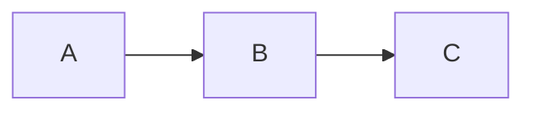

# Documentation Site

## Purpose and content budget

- `capsem.org` answers: “Why Capsem, what can I do, and how quickly can I get value?” Marketing owns benefits, use cases, and the short path to value; see `/site-marketing`.
- `docs.capsem.org` answers: “Exactly how does this work, how do I operate/integrate/administer it, and what is the contract?” Docs owns precise procedures, behavior, configuration, interfaces, limits, and guarantees.

Write the minimum content on the minimum number of pages needed to answer
those documentation questions completely. Prefer a section in an approved
page and links to the canonical explanation over another page or duplicated
prose. A feature, subsystem, troubleshooting case, or release does not
automatically earn a page. Keep necessary prerequisites, defaults, failure
behavior, and security limits; brevity must not make the contract ambiguous.

**New pages require explicit user approval before creation.** A general request
to improve or rebuild docs is not approval for an agent-chosen page list.
The user will tell us what to write. Do not proactively propose pages, page
lists, outlines, or documentation topics. Follow the user's supplied scope and
record page approval in the owning Sprinty item. New categories and page splits
follow the same rule. Edit approved pages within their agreed scope without
asking again.

## Rebuild from scratch

The documentation rebuild starts from reader needs and current product
contracts. The old manual is reference material, not the target information
architecture or a backlog of stubs to fill.

1. Wait for the user to specify what to write and which pages to create or edit.
2. Keep that requested content on the fewest approved pages, using related
   sections and canonical links instead of duplicating explanations.
3. Write the requested content afresh from current code, schemas, CLI/API contracts,
   and verified behavior. Reuse old text only after checking it against those
   sources; do not carry forward historical commands or claims by default.
4. Review for completeness, duplication, and removable prose. Verify commands,
   links, and examples with the relevant project skills and bounded rails.

Approval of content or page structure does not itself authorize publication.
Preserve the holding/tombstone safeguards below until the replacement manual
and its publication are approved.

## Source and current publication state

The detailed documentation source for docs.capsem.org is authored for
[Astro Starlight](https://starlight.astro.build/) and lives in
`web/docs/src/content/docs/` as Markdown/MDX files. During the Capsem 0.6
pre-release, the production Astro build deliberately does not register the
Starlight integration: it publishes `web/docs/src/pages/index.astro` as the root
holding page and derives a noindex holding tombstone for every former detailed
route while every source file remains checked in.

## Dev workflow

```bash
uv run --project build_system --frozen python build_system/scripts/ci/run-bounded-command.py --timeout-seconds 120 -- pnpm --dir web/docs run dev
uv run --project build_system --frozen python build_system/scripts/ci/run-bounded-command.py --timeout-seconds 300 -- pnpm --dir web/docs run build
```

## CI and deploy rail

`ci.yaml` runs the merge-blocking `docs-build` job under `pr-gate`. `docs.yaml`
deploys only on every push to `main` and smokes `https://docs.capsem.org/`, then
requires the warmed `/getting-started/` tombstone markers while rejecting its
old guide/install content. This deploy rail is independent from binary releases,
manual VM asset releases, and the `release.capsem.org` asset-channel workflow.

## Capsem 0.6 holding boundary

- Do not delete or rewrite the detailed manual to produce the holding page.
- `web/docs/src/pages/[...slug].astro` derives one static noindex tombstone from
  every detailed Markdown/MDX source except the root `index.mdx`. A removed
  path is not enough: Cloudflare can continue serving a warmed old asset after
  deletion, so each former URL must be replaced explicitly.
- `web/docs/public-holding/_headers` applies no-store browser/CDN policy and an
  `X-Robots-Tag` to the complete qualification surface.
- `build_system/scripts/web/check-docs-holding-build.py` independently derives the exact
  tombstone inventory from the manual sources. It permits only those files,
  the root holding page, a top-level `404.html`, and `_headers`; it rejects
  unexpected artifacts and old Starlight, installation, release, or deep-doc
  content.
- The holding page must say that 0.6 is in pre-release qualification and must
  not offer installation instructions or release downloads.
- Restoring detailed routes is a separate publication decision: register
  Starlight again only when the 0.6 documentation is approved for release.

## Writing style

Tight and to the point, like a manual. Organize each approved page around a
coherent reader task or contract, with related details in sections. No filler,
marketing pitches, speculative features, or exhaustive tours of internals.
Use tables for comparable settings or interface fields, code examples when
needed to perform a task, and Mermaid diagrams when they clarify behavior.
Link to marketing for rationale; keep technical truth in one canonical place.

## Frontmatter

Every doc page must include `title` and `description`. Starlight handles `lastUpdated` from git history automatically. No `layout:` field -- Starlight provides its own.

The `description` is always the reader's question that the page answers,
phrased as a direct question ending in `?`. Keep it specific to the page's
scope; do not use a summary, slogan, or imperative. Apply this rule to every
new page and whenever an existing page is rewritten.

```markdown
---
title: Page Title
description: How do I install Capsem on my computer?
sidebar:
  order: 10
---
```

## Approved pages and navigation

After approval, create the agreed Markdown/MDX path under
`web/docs/src/content/docs/` with the frontmatter above. When Starlight is
restored, configure its sidebar in `web/docs/astro.config.mjs` to match the
approved page list; `sidebar.order` controls order within a section. Do not
turn every source directory into a navigation category.

A minor release does not authorize a new release page. Use `CHANGELOG.md`
for release history and update the approved manual where behavior changed.
Create a separate release page only when the user requests and approves it.

## Mermaid diagrams

The site uses `astro-mermaid` for rendering. Use fenced code blocks:

````markdown

````

## Astro reference

Read `references/astro.md` for Astro framework patterns (components, content collections, SSR, CLI). From the official Astro team.

## Theme

Custom CSS in `web/docs/src/styles/custom.css`. Accent colors and fonts. Logo at `web/docs/src/assets/logo.svg`.

## Graphics and icons

Source of truth for all icons: `web/graphics/`.

```
web/graphics/
  icon/                        Brand icon in multiple sizes and variants
    icon-mainfile.ai           Illustrator source file
    22w/                       22px (menu bar)
    1x/                        726px (standard)
    2x/                        1450px (retina)
    3x/                        2176px
    4x/                        2900px
    1024w/                     1024px (app store, high-res)
    Variants: capsem-logo-{black,color,grey,white}.png
  tauri/                       Pre-built Tauri app icon set
    32x32.png, 128x128.png, 128x128@2x.png
    icon.icns, icon.ico, icon.svg
```

Site favicons in `web/docs/public/` are generated from `web/graphics/icon/1024w/capsem-logo-color.png`. To regenerate:

```bash
sips -z 16 16 web/graphics/icon/1024w/capsem-logo-color.png --out web/docs/public/favicon-16x16.png
sips -z 32 32 web/graphics/icon/1024w/capsem-logo-color.png --out web/docs/public/favicon-32x32.png
sips -z 180 180 web/graphics/icon/1024w/capsem-logo-color.png --out web/docs/public/apple-touch-icon.png
sips -z 192 192 web/graphics/icon/1024w/capsem-logo-color.png --out web/docs/public/android-chrome-192x192.png
sips -z 512 512 web/graphics/icon/1024w/capsem-logo-color.png --out web/docs/public/android-chrome-512x512.png
```

## Keep docs in sync

For requested documentation updates, edit the corresponding approved page and verify it
against the owning source contract. Consolidate overlapping explanations and
remove obsolete claims within the requested scope. Do not create pages or stubs
automatically; the user directs what to write and approves any new page.
