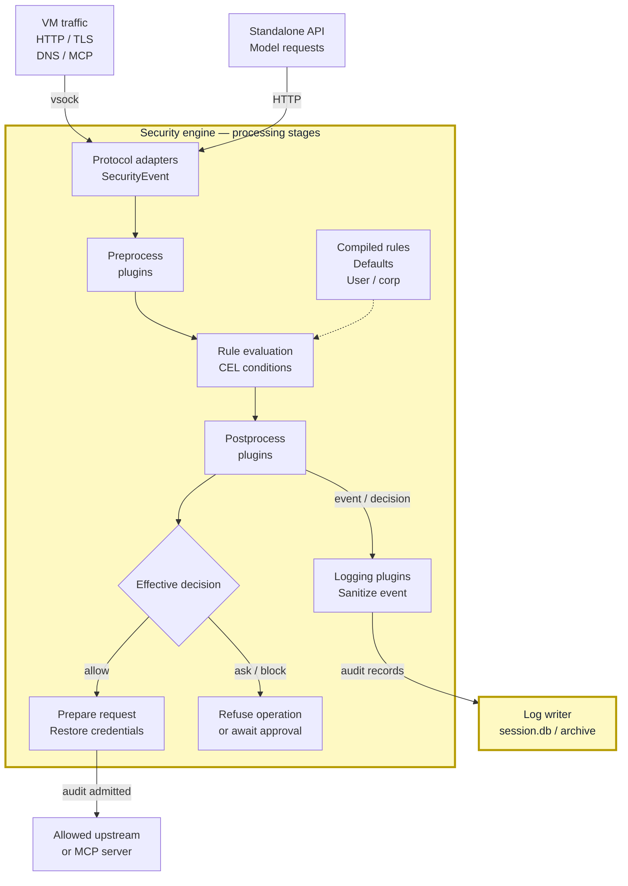

<!-- Explanation for the completed 0.7/#206 target. Process extraction,
standalone API adapter and sandbox grants require implementation verification
before publication. The pipeline below follows capsem-core/security_engine. -->

The security engine turns operations into structured events, applies plugins
and rules, and returns a decision. Allowed operations proceed; sanitized events
go to the log writer.

## Event flow

Boxes inside the engine are processing stages, not separate processes. Yellow
means access to assigned files, credentials, and upstreams; see the
[process boundaries and permission legend](/architecture/security/).
Responses and model messages also produce events before returning data to the caller.

## Responsibilities

| Component | Role | Boundary |
| --- | --- | --- |
| Protocol adapters | Parse HTTP, TLS, DNS, MCP, and model traffic into `SecurityEvent` facts. | Parsing does not choose policy or inject credentials. |
| Preprocess plugins | Enrich or change the event before rules run. The credential broker records credential references. | Plugins receive and return a `SecurityEvent`. |
| Rules | Evaluate CEL conditions against typed event facts; record matches and select enforcement. | Defaults, user settings, and corp rules compile into one `SecurityRuleSet`. Corp constraints take precedence. |
| Postprocess plugins | Update the evaluated event and request a stricter decision when needed. | Decisions only tighten: `allow` → `ask` → `block`. A plugin cannot undo a block. |
| Runtime request preparation | Restore real credentials into an allowed upstream request. | Uses credentials assigned to the VM and destination; refused operations are not forwarded. |
| Logging plugins | Prepare a separate event for storage, replacing observed secrets with references or redacted values. | Real credentials restored for an upstream request do not belong in its stored event. |
| Log writer | Store events, matched rules, decisions, plugin execution evidence, and body records. | A separate confined process owns SQLite and archive access. The engine sends typed records; it does not open `session.db`. |

`ask` does not mean allow: the operation cannot proceed until approval is
resolved. If a required audit record is refused, the operation is refused too.
Network connection and probe events require an explicit allow rule.

## Enforcement and observation

| Event source | What the engine can do |
| --- | --- |
| Proxied requests, responses, and model messages | Decide before forwarding to the upstream or caller. |
| Host-requested command execution and file operations | Decide at the operation's boundary before dispatch. |
| Guest process audit records | Record and detect an operation that already happened. An audit record cannot stop it retroactively. |
| Standalone model API | Apply the same model policy, credential handling, and logging without launching a VM. It sees only requests sent to this endpoint. |

Private VM networks and exposed ports use separate relays; they do not pass
through HTTP inspection. See [network connections](/architecture/security/#network-connections).

## Worker permissions

Before accepting VM traffic, the worker receives its VM's policy, certificates,
credentials, allowed upstream authority, and log-writer connection, then enters
its OS sandbox. It has no VM-control authority, another VM's credentials, or
direct ledger access. The exact macOS Seatbelt and Linux Landlock/seccomp
allowlists remain to be finalized in [#206](https://github.com/google/capsem/issues/206).
