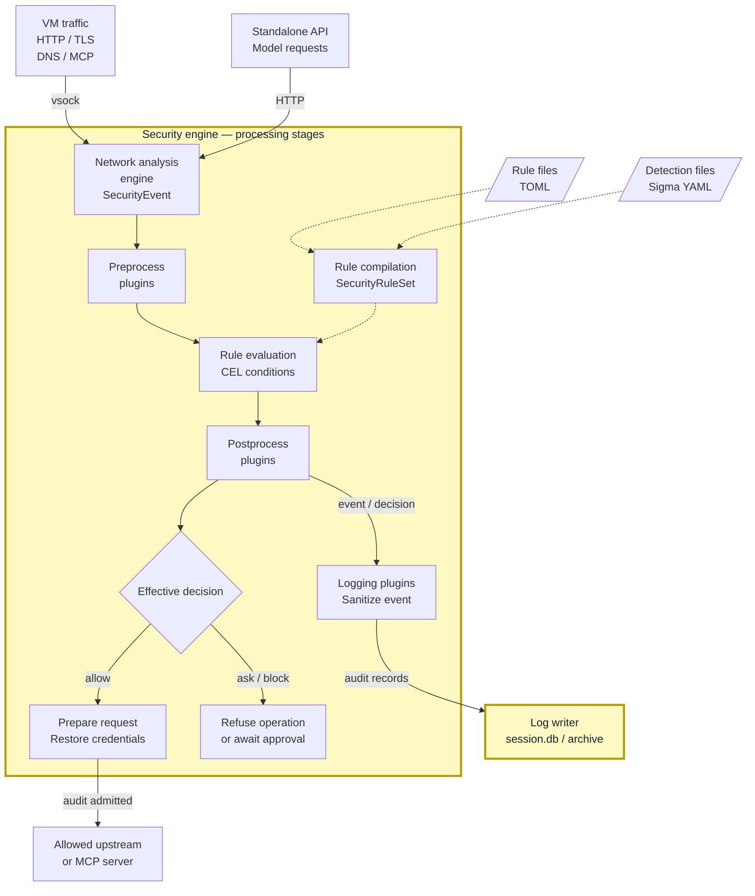

<!-- Explanation for the completed 0.7/#206 target. Process extraction,
standalone API adapter and sandbox grants require implementation verification
before publication. The pipeline below follows capsem-core/security_engine. -->

The security engine is a host subprocess assigned to one VM. It is responsible for:

- **Network analysis:** decrypt HTTPS and identify the destination, HTTP request,
  model call, or MCP tool call being made.
- **Security decisions:** check those facts against rules and detections before
  forwarding traffic. Refuse blocked requests and requests awaiting approval.
- **Credentials:** replace credential references with the real credentials
  assigned to the VM and destination, after the request is allowed.
- **Audit records:** remove observed secrets from the recorded data and send the
  request, decision, and detections to the log writer.

It sits inside the [per-VM process group](/architecture/security/), outside the VM's hardware boundary.

## Event flow

For an HTTPS request, the network analysis engine terminates TLS and extracts
facts such as the hostname, method, and URL. Preprocess plugins prepare those
facts for rule evaluation, including identifying credentials. Rules match the
facts; postprocess plugins can tighten the decision. An allowed request gets
its assigned credentials and is forwarded. A separate sanitized copy goes to
the log writer, so restoring a secret for the upstream does not put that secret
in the stored record.
Responses and model messages are also evaluated before being forwarded to the caller.

## Responsibilities

| Component | Role | Boundary |
| --- | --- | --- |
| Network analysis engine | Terminate TLS, parse requests and responses, and identify HTTP, DNS, MCP, and model facts. | Produces `SecurityEvent` data for evaluation; does not choose policy or inject credentials. |
| Preprocess plugins | Prepare facts before rule evaluation. The credential broker identifies credentials, records their references, and marks requests needing credential substitution. | Rules inspect the prepared event. |
| Rules | Evaluate CEL conditions against typed event facts; record matches and select enforcement. | Defaults, user settings, and corp rules compile into one `SecurityRuleSet`. Corp constraints take precedence. |
| Postprocess plugins | Inspect or change the event after rule evaluation; they may require approval or block an otherwise allowed operation. | Decisions only tighten: `allow` → `ask` → `block`. A plugin cannot undo a block. |
| Runtime request preparation | Restore real credentials into an allowed upstream request. | Uses credentials assigned to the VM and destination; refused operations are not forwarded. |
| Logging plugins | Prepare a separate event for storage, replacing observed secrets with references or redacted values. | Real credentials restored for an upstream request do not belong in its stored event. |
| Log writer | Store events, matched rules, decisions, plugin execution evidence, and body records. | A separate confined process owns SQLite and archive access. The engine sends typed records; it does not open `session.db`. |

`ask` does not mean allow: the operation cannot proceed until approval is
resolved. If a required audit record is refused, the operation is refused too.
Network connection and probe events require an explicit allow rule.

## Rule and detection inputs

| Input | Contents | Loaded through |
| --- | --- | --- |
| Rule file (TOML) | CEL conditions, actions such as `allow`, `ask`, or `block`, priorities, and optional detection levels. | `rule_files.enforcement` in user settings or corp configuration. |
| Detection file (Sigma YAML) | Selections, a condition, and a detection level over Capsem security events. Optional `capsem.action` can also request enforcement. | `rule_files.sigma` in user settings or corp configuration. |

Both files compile into the same `SecurityRuleSet`, alongside built-in defaults
and inline rules. Corp constraints take precedence. Relative file paths are
resolved from the configuration file's directory. A detection records a match
and its level; it does not automatically block the operation.

## Enforcement and observation

| Event source | What the engine can do |
| --- | --- |
| Proxied requests, responses, and model messages | Decide before forwarding to the upstream or caller. |
| Host-requested command execution and file operations | Decide at the operation's boundary before dispatch. |
| Guest process audit records | Record and detect an operation that already happened. An audit record cannot stop it retroactively. |
| Standalone model API | Apply the same model policy, credential handling, and logging without launching a VM. It sees only requests sent to this endpoint. |

Private VM networks and exposed ports use separate relays; they do not pass
through HTTP inspection. See [network connections](/architecture/security/#network-connections).

## Worker permissions

Before accepting VM traffic, the worker receives its VM's policy, certificates,
credentials, allowed upstream authority, and log-writer connection, then enters
its OS sandbox. It has no VM-control authority, another VM's credentials, or
direct ledger access. The exact macOS Seatbelt and Linux Landlock/seccomp
allowlists remain to be finalized in [#206](https://github.com/google/capsem/issues/206).
