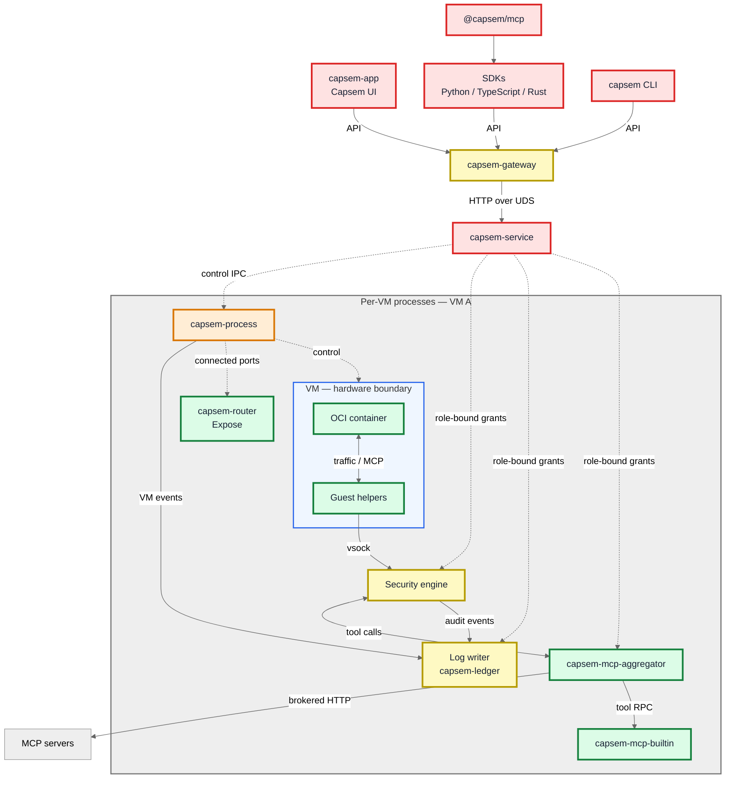
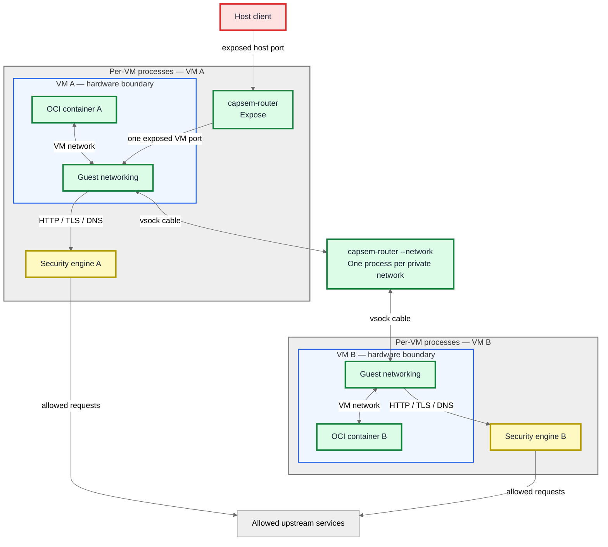

Capsem runs OCI containers inside separate VMs. Host processes handle VM
control, proxy traffic, MCP tools, network connections, and log storage.

See the [security engine](/architecture/security-engine/) for event processing,
rule decisions, credentials, and logging.

Colors show the host permissions available if a process is compromised:

| Color | Host permissions |
| --- | --- |
| 🟢 Green — minimum | Granted connections only; no arbitrary host files or new connections. |
| 🟡 Yellow — limited | Assigned files, credentials, or upstream connections. |
| 🟠 Orange — elevated | VM control and virtualization resources. |
| 🔴 Red — maximum | Full launching-user permissions or trusted coordinator authority. |

Grey groups identify ownership by one VM. Blue outlines mark VM hardware
boundaries. External systems are uncolored; client colors assume an ordinary
user application without a Capsem-installed sandbox.

## Processes and control

Dashed arrows: control. Solid arrows: data.

## Network connections

The private-network switch is shared by the VMs attached to that network.

## Roles and sandboxing rules

Worker startup closes unrelated handles and clears inherited environment data.
Readiness follows confinement and denial checks; failure aborts startup.

On Linux, worker policies install Landlock filesystem/network/signal restrictions
and seccomp syscall filters. On macOS, Seatbelt receives canonical path grants.
The table lists each role's specific grants and exceptions.

| Process | Role | Sandboxing rules |
| --- | --- | --- |
| `capsem-service` | Shared coordinator and authority broker. | Trusted with the launching user's permissions. Owns worker lifetimes, policy, credential storage, connection admission, and ledger commitments. Grants identify a VM, generation, and role; clients cannot select another worker by supplying a path. |
| `capsem-gateway` | Authenticated API for CLI, TUI, Capsem UI, SDKs, and host MCP. | Bind API/preview listeners and prepare runtime-file handles before confinement. **Linux:** Landlock grants no paths; seccomp permits accept on inherited listeners and I/O on granted coordinator channels. **macOS:** Seatbelt denies ambient file reads/writes, bind/connect, exec, and unrelated signals; permits inbound acceptance and exact token/port/PID/preview/log paths. No direct VM-owner socket dialing. |
| `capsem-process` | Boot and control one VM. | Preopen workspace and IPC/vsock handles, then confine before hypervisor and worker threads start. Writable grants: own guest share, system overlay, owner-state directory, serial/PTY logs, and `/dev/null`. Read-only grants: runtime assets and immutable image share. **Linux:** Landlock/seccomp grant required KVM/vhost-vsock device operations, system libraries, and the router executable/loader. **macOS:** Seatbelt grants required system libraries and the router executable; the binary has the virtualization entitlement. Ledger files, sibling VMs, ambient outbound dialing, and unrelated signals are denied. Permission/timestamp changes use the coordinator broker. |
| VM | Own Linux kernel and memory. | Apple Virtualization.framework or KVM hardware boundary. No host-network NIC. Only its guest share and read-only image share are mounted; the writable system overlay and ledger remain outside the guest share. |
| OCI container | Agent and tools inside the VM. | `runc` creates user/PID/mount/IPC/UTS/network namespaces; `noNewPrivileges=true`; cgroup CPU/memory/PID limits. Seccomp denies vsock sockets; no `CAP_SYS_ADMIN`. Terminal images cannot create namespaces; the graphical workload allows the namespaces Chromium needs. Its container root is writable. |
| Guest helpers | Terminal, network, and MCP transport inside the VM. | Outside the OCI container but inside the hardware boundary. Open assigned vsock channels on behalf of the container; they have no host filesystem grant. |
| Security engine (`capsem-proxy`) | Parse traffic, evaluate policy, prepare credentials, and submit audit records. | Clear environment/handles; prepare a single-thread runtime; install confinement with **no filesystem path grants** before readiness. **macOS:** deny-default Seatbelt. **Linux:** Landlock plus seccomp deny file opens, socket creation/dialing, exec, and unrelated signals. Receives exact policy bytes, connected upstream descriptors, and typed credential/MCP/ledger capabilities. Cannot open credential storage or `session.db`. |
| Log writer (`capsem-ledger`) | Store and query one VM's ledger and body archive. | Resolve its database directory, prepare a single-thread runtime, then confine before opening storage. **macOS:** deny-default Seatbelt grants that ledger directory. **Linux:** Landlock grants that directory; seccomp permits storage/runtime I/O while denying ambient networking, exec, and unrelated signals. Uses memory for temporary storage. Producer, reader, and maintainer operations arrive over distinct granted channels. |
| `capsem-mcp-aggregator` | Dispatch MCP requests to configured servers and builtins. | Validate generation/role and adopt connected channels; confine and attest before readiness. **macOS:** deny-default Seatbelt with no path grants. **Linux:** Landlock/seccomp deny ambient files, sockets, fork/exec, and unrelated signals; runtime threads remain permitted. Holds a brokered HTTP capability for configured servers and a narrow builtin-spawn RPC; the service creates and reaps children. |
| `capsem-mcp-builtin` | Execute first-party HTTP tools. | Same descriptor-only confinement and startup checks as the aggregator, with a separate builtin role and HTTP capability. The service checks current destination/address policy. No policy files, host credentials, ledger files, or VM controls. |
| `capsem-router` (expose) | Relay one VM's published ports. | Close inherited handles; initialize runtime/parent watch; confine before the first connection grant. **macOS:** deny-default Seatbelt. **Linux:** `no_new_privs` and seccomp `TSYNC` across runtime threads. Only connected-handle I/O, polling, memory, and shutdown are allowed: no file opens, connect, accept, clone, exec, or signals. The owner accepts on coordinator-granted listeners and passes connected pairs. |
| `capsem-router --network` | Switch cables for one private network. | Same descriptor-only router sandbox. Receives member cable descriptors; no files, listener acceptance, fresh connections, or internet uplink. Handles all protocols without HTTP inspection. |
| CLI / Capsem UI / TUI / tray | User interfaces. | Launching application's permissions; no Capsem worker sandbox. VM operations use authenticated gateway requests. Local CLI service startup/status/asset administration retains its separate local administration path. |
| SDKs / `@capsem/mcp` | Application and host MCP clients. | Inherit the application or host MCP process permissions. SDK libraries do not install an OS sandbox or receive direct VM-owner IPC. |

## Authentication and grants

The gateway authenticates clients before forwarding API requests. The service
authenticates native worker channels and binds each grant to its original
process generation and role. A connected descriptor permits I/O on that
connection; it does not permit opening another destination.

The service admits upstream addresses from trusted policy and supplies connected
descriptors. Security engines and MCP workers request these through their own
capabilities; neither receives permission to dial arbitrary host addresses.

## Failure and revocation

Stopping or replacing a VM retires its original worker generation and revokes
its capabilities. A delayed message from the old generation cannot acquire the
replacement's authority. Worker startup fails if confinement or readiness fails.
A dead proxy stops the matching VM owner; refused required audit admission
refuses the operation.

The host kernel, hypervisor, and service remain trusted. The ledger detects
changes to checkpointed records, but cannot prove that a compromised producer
reported an observation truthfully or recover an uncommitted crash tail.
