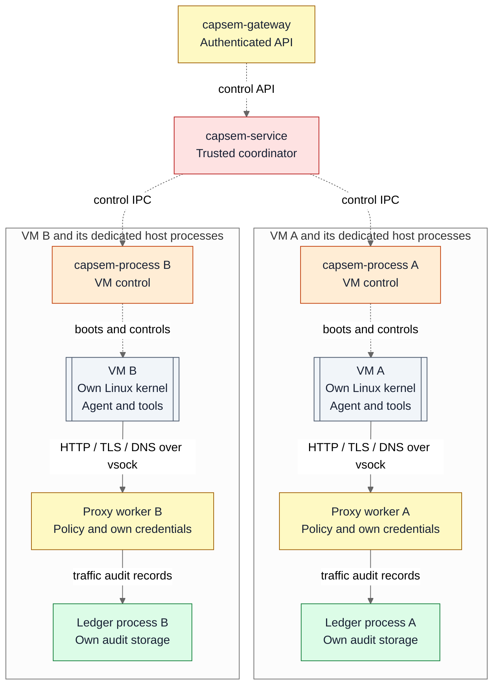
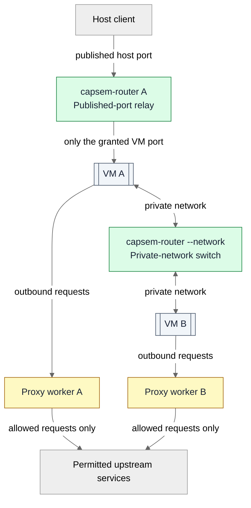

<!-- Authoring target: Capsem 0.7 with #206 completed, including its #289
configuration amendment. This draft is not proof that the current checkout
implements every target boundary. Publish only after the final boundaries
are implemented and verified. -->

Capsem treats the code inside a VM, and the traffic it produces, as untrusted.
Its security model combines three boundaries: a VM separates that code from
your computer, OS sandboxes limit the host processes handling it, and network
policy controls which outside services it can reach.

The aim is to contain a compromise: gaining control of one VM or its proxy
must not grant access to another VM's files, credentials, or controls.

**Privilege legend:** red is the trusted coordinator; orange is scoped VM
control; yellow is scoped API or upstream access; green is storage-only or
connection-only access. Each colored box except the trusted coordinator is a
separate OS-sandboxed process. Grey boxes are separate hardware-isolated VMs.

Dashed arrows show VM control. Solid arrows show the path from VM traffic to
its proxy and audit storage. The coordinator also grants each proxy its policy
and permitted connections; VM owners write their audit records to the same
VM-specific ledger. The network routes are shown separately below.

VM A and VM B have separate workers. The surrounding groups show assignment,
not a shared sandbox; neither VM's workers receive authority over the other's
resources.

## Process isolation

Each VM runs its own Linux kernel using Apple's Virtualization.framework on
macOS or KVM on Linux. The selected image runs inside a sandbox within that
VM, rather than sharing your computer's kernel. Guest sandboxing restricts
privileges and system calls, including direct access to the host's vsock
channels. The VM boundary remains separate from the image's sandbox.

The host also separates responsibilities into processes. The VM owner manages
virtualization; a proxy worker handles untrusted network traffic; a ledger
process stores and queries audit records. Separating them keeps a network
parser or database bug from automatically gaining VM-control authority.

| Process | Permitted authority |
| --- | --- |
| `capsem-service` | Trusted coordinator for VM lifecycle, configuration, and scoped permissions. |
| `capsem-gateway` | Authenticated API access and authorized control/terminal connections. |
| `capsem-process` | One VM's virtualization resources, files, read-only runtime assets, and control channels. |
| Proxy worker | One VM's traffic, policy, granted credentials, and approved upstream connections. |
| Ledger process | One VM's audit storage and granted read/write connections; no network access or program execution. |
| `capsem-router --network` | Only the connections belonging to one private network. |
| `capsem-router` for a published port | Only the granted connections for that VM port. |

The CLI, TUI, Capsem UI, SDKs, and host MCP reach VM controls through the
service. They do not connect directly to a VM owner's private control socket.

## Privilege separation and sandbox boundaries

A separate process is not enough: processes running as the same user normally
share that user's access to files and sockets. Private directory permissions
and clearing environment variables help, but do not prevent sibling access.

**Privilege separation** gives each process only the authority needed for its
job. The VM owner can control its VM but does not also parse its web traffic.
The proxy can inspect and forward permitted requests but cannot control VMs.
The ledger can store and query its VM's records but cannot make network
connections or launch programs. The trusted coordinator grants these roles;
workers cannot grant themselves more authority.

OS sandboxes enforce the limits in the table. macOS uses Seatbelt policies;
Linux uses Landlock for filesystem restrictions and seccomp for permitted
system calls. Descriptor-only switches and relays use existing granted
connections instead of permission to open arbitrary paths or connections.
Each policy allows only the operations that process needs for its role.

Confinement is installed before untrusted input is accepted. If it cannot be
installed, the worker does not become ready. The coordinator binds each grant
to the assigned VM and the current worker lifetime; supplying another VM's
name, ID, or path cannot expand a worker's access. Replacing a worker requires
fresh grants, so an old connection cannot act for its replacement.

Guest-writable files are separate from host-only runtime disks and audit
storage. Host access to guest-writable files is contained and does not follow
links outside the allowed directory. These file boundaries complement the
OS sandbox rather than depending on the guest to respect them.

## Network isolation

This example joins VM A and VM B to one private network and publishes a port
from VM A. These are separate routes with different permissions:

The published port reaches VM A through its relay. VM A and VM B exchange
private traffic through their shared switch. Requests to outside services
take each VM's own proxy path; neither the switch nor the published port
provides a direct internet route.

### Internet traffic is mediated

A VM has no direct network connection to the internet or your computer's
network. Guest helpers send supported outbound traffic over **vsock**, a
host–VM transport, to that VM's proxy worker. DNS and HTTP/HTTPS processing,
security policy, and credential handling live in that confined worker.

For HTTPS inspection, TLS terminates at the proxy and a separate connection
is made to an allowed upstream. Policy controls which requests proceed;
unsupported traffic does not gain a direct route around the proxy. The
worker receives only its assigned credentials and upstream authority, not
permission to dial arbitrary destinations or use another VM's credentials.
Secrets are redacted before traffic records enter the ledger.

### Private networks are deliberate connections

VMs start without connections to other VMs. Joining a private network grants
communication with its members through a confined switch. The switch has no
internet uplink and does not connect unrelated private networks.

Membership is the permission to communicate: VMs on the same private network
can exchange traffic using any protocol. That traffic is not routed through
the internet proxy or subjected to its HTTP policy. A private network is a
shared communication space, not an isolation boundary between its members.

### Published ports are narrow grants

Publishing a VM port creates an explicit host-side route to that port through
a confined relay. The relay holds the connections it was granted; it cannot
turn that route into arbitrary host access or access to another VM. Publishing
a port does not give the VM a general internet connection.

## Trust and failure boundaries

The host OS, hypervisor, and `capsem-service` remain trusted. These boundaries
limit a compromised guest or worker; they do not protect against a compromised
host administrator or kernel. A compromised proxy can misuse authority granted
to its own VM, so those grants must stay narrow.

If a proxy or ledger fails, affected operations fail explicitly and their
resources remain bounded. Security-sensitive actions that require an audit
record are refused if that record cannot be accepted. Other VMs retain their
separate workers and authority. An accepted record is not necessarily committed
to durable storage, and audit records alone do not prove every action was seen.

`capsem proxy` reuses the proxy engine in a separate proxy instance without
booting a VM. It controls only model requests sent to its OpenAI-compatible
endpoint; it does not sandbox its client or prevent other network access.
That data endpoint is unauthenticated, so deployment/network controls must
restrict access. It is separate from the authenticated SDK/control gateway.
