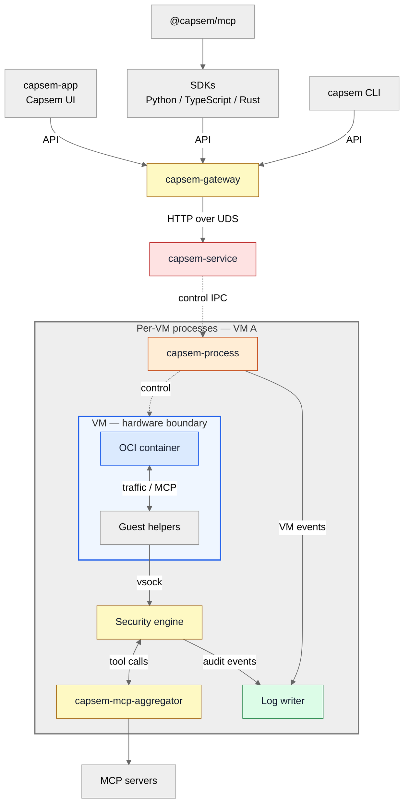
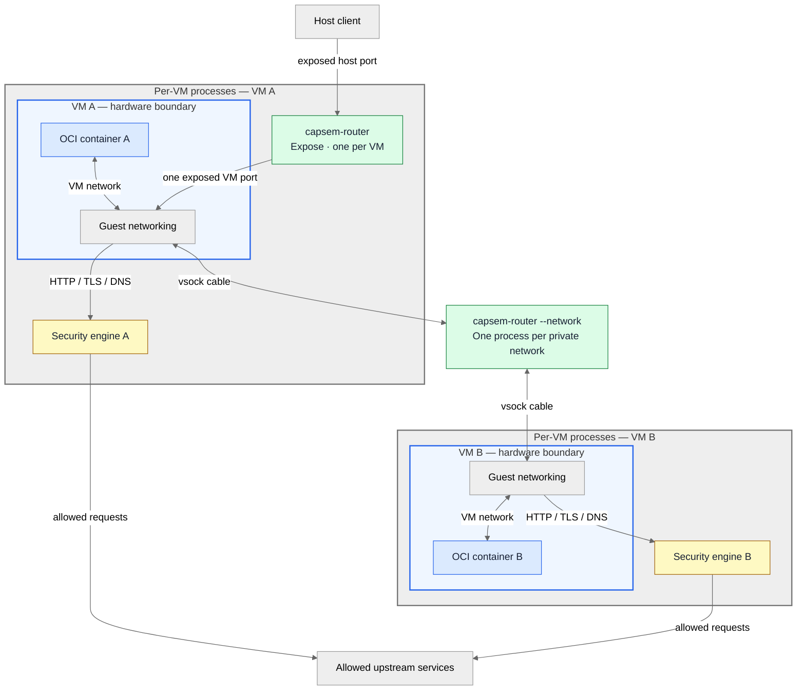

<!-- Authoring target: completed Capsem 0.7/#206, including #289.
Worker boundaries below must be implemented and verified before publication. -->

Capsem runs OCI containers inside separate VMs. Host processes handle VM
control, proxy traffic, MCP tools, network connections, and log storage.

## Processes and control

Grey group: one VM's processes. Blue outline: VM hardware boundary.
Outside the grey group: shared components. Dashed arrows: control; solid: data.

## Network connections

The expose router belongs to VM A. The private-network switch is shared by
the VMs attached to that network; it is not a per-VM process.

## Roles and sandboxing rules

| Process | Role | Sandboxing rules |
| --- | --- | --- |
| `capsem-service` | Global VM coordinator. | Trusted; no worker sandbox. Clears worker environments and closes unrelated inherited handles. Grants carry VM identity and worker generation. |
| `capsem-gateway` | Shared authenticated API for all clients. | Startup policy allows API listener/accept, service and terminal IPC, required runtime/log files. Denies arbitrary files, exec, unrelated process signals, and ungranted outbound connections. Exact Seatbelt/Linux allowlists: #206. |
| `capsem-process` | One VM's boot and control. | Own VM directory read/write; runtime assets read-only; own IPC/vsock handles. macOS policy allows required Virtualization.framework operations and entitlement; Linux allows required KVM device operations. Other VM directories/sockets denied. Exact OS allowlists: #206. |
| VM | Own Linux kernel. | Apple Virtualization.framework or KVM. No host-network NIC. Runtime assets and injected binaries read-only; own writable overlay/workspace. |
| OCI container | Agent and tools inside the VM. | `runc` creates user/PID/mount/IPC/UTS/network namespaces; `noNewPrivileges=true`; cgroup CPU/memory/PID limits. Moby-based seccomp denies vsock sockets; no `CAP_SYS_ADMIN`. Terminal images cannot create namespaces; Xpra permits Chromium's user/PID/network namespaces. Container root is writable. |
| Guest helpers | Guest-side terminal/network/MCP transport. | Outside the OCI container, inside the VM. Open assigned vsock channels; the container cannot open them directly. No host Seatbelt/Landlock profile. |
| Security engine | One VM's proxy, TLS/DNS, rules, credentials, and MCP policy. | Install confinement before guest input. Grant only its policy, certificates, credentials, approved upstream connections, and log-writer connection. Deny database paths, VM control, sibling credentials, arbitrary dialing, exec, and unrelated signals. Exact Seatbelt/Linux allowlists: #206. |
| Log writer | One VM's audit storage and queries. | Load libraries, then confine; temporary storage in memory. **macOS:** deny-default Seatbelt; allow only own `session.db`, WAL/SHM, archives, locks; deny network and `process-exec`. **Linux:** Landlock allows only that session directory; seccomp permits storage/runtime calls, denies socket creation and exec. Granted producer/reader connections only; no virtualization entitlement. |
| `capsem-mcp-aggregator` | Per-VM MCP server connections and dispatch. | Needs configured server connections and stdio children. Separate OS profile not specified in #206; tool permissions do not establish filesystem/syscall confinement. |
| `capsem-mcp-builtin` | Built-in HTTP MCP tools. | Requires outbound HTTP. Separate OS profile not specified in #206; tool policy is not an OS sandbox. |
| `capsem-router` (expose) | One VM's published ports. | Close inherited handles above stdin/stdout/stderr; start runtime and parent watch; confine before first grant. **macOS:** `sandbox_init("(version 1)(deny default)")`. **Linux:** `no_new_privs` + seccomp `TSYNC` on all threads. Allow existing-handle I/O, polling, memory, shutdown; deny open/connect/accept/clone/exec/signals. Receive connected handle pairs; no listener acceptance or virtualization entitlement. |
| `capsem-router --network` | One private network's VM cables. | Same startup and OS rules as expose. Only that network's cable handles; no file opens, listener, new connections, or internet uplink. Member traffic uses any protocol and bypasses HTTP inspection. |
| `capsem` / `capsem-app` / `capsem-tui` / `capsem-tray` | CLI and UI clients. | Launching user's permissions; no worker-sandbox guarantee. Authenticated gateway API; no direct VM-owner IPC. |
| SDKs / `@capsem/mcp` | Application and host-MCP clients. | SDKs inherit application permissions; install no OS sandbox. Host MCP uses the SDK under its launching user's permissions. |
