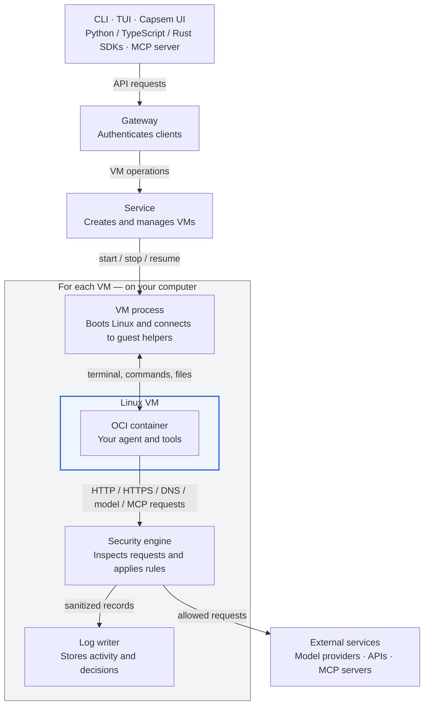

Capsem runs AI agents and tools in Linux VMs on your computer.
A shared service manages the VMs, a security engine checks their outbound
requests, and a log writer records their activity.

## How the components connect

The gateway and service are shared by all VMs. Each VM has its own VM process,
security engine, and log writer; these run on your computer, outside the VM.

| Component | What it does |
| --- | --- |
| CLI and terminal interface (TUI) | Run `capsem` commands and work in VM terminals from your terminal. |
| Capsem UI | Web interface for VM terminals, files, logs, and activity. Open it in your browser or through the Capsem desktop app. |
| SDKs and MCP server | Automate VMs from Python, TypeScript, or Rust, or let an AI agent operate them through MCP. The MCP server uses the TypeScript SDK. |
| Gateway | Authenticates clients and passes their requests to the service. |
| Service | Manages VM storage, configuration, credentials, and worker processes. |
| VM process | Boots the VM and connects terminal, command, and file operations to its guest helpers. |
| Linux VM and OCI container | Linux supplies the VM's kernel and filesystem. The OCI image supplies the agent and tools that run inside it. |
| Security engine | Parses network, model, and MCP requests, applies enforcement and detection rules, and forwards allowed requests with authorized credentials. |
| Log writer | Stores VM activity and sanitized security records for inspection through the UI, CLI, or SDK. |

## What happens when you use a VM

When you create a VM, the service prepares its files and starts its processes.
The VM process boots Linux and starts the software from your chosen image.
You can then open a terminal or run commands through the same gateway and service.

When the agent calls a model, API, or MCP tool, guest helpers send the request
to the security engine. The engine checks the request against your rules,
adds authorized credentials where needed, and forwards it if allowed.
The log writer stores the activity and decisions so you can investigate what happened.
To understand what is inspected and recorded, see [how the security engine processes requests](/architecture/security-engine/).

VMs can also join a private network or publish a port through a separate relay.
These connections follow [separate network paths](/architecture/security/#network-connections).

Named VMs keep their files when stopped. Use `capsem resume` to return to a
suspended VM, or `capsem fork` to copy a prepared VM into another VM.
See [how to use Capsem](/getting-started/how-to-use-capsem/).

## Install Capsem

[Install Capsem](/getting-started/installation/) on your computer first.
Installation sets up the service, command-line tools, and Capsem UI.

## Choose how to use it

After installation, you can use the same VMs through any of these interfaces:

- **Terminal:** [create and access a VM](/getting-started/how-to-use-capsem/), then [run commands and transfer files](/guides/users/use-the-terminal/).
- **Capsem UI:** use the web interface to open a VM terminal and inspect its files, logs, and activity. [Open the Capsem UI](/getting-started/how-to-use-capsem/#from-the-capsem-ui).
- **SDK:** [automate VMs](/sdk/) from Python, TypeScript, or Rust.

To manage policy and images for your organization, see [Deploy Capsem in your enterprise](/guides/enterprise/deploy-capsem/).
