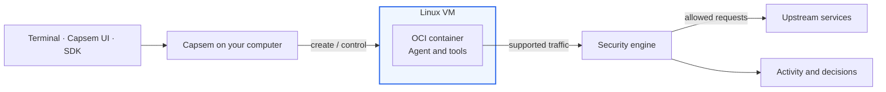

Capsem runs AI agents and tools inside Linux VMs on your computer.
Choose an image for the software you need, then use the terminal, Capsem UI,
or SDK to work in the VM and inspect its activity.

## What runs where

Each VM has its own kernel and files. An OCI image supplies its agent and tools;
the container runs inside the VM. Named VMs retain work for reuse or duplication.

## Protection layers

| Layer | Controls |
| --- | --- |
| VM | Separates guest execution from the host kernel. |
| OCI container | Organizes the workload inside the VM with namespaces and resource limits. |
| Host worker sandboxes | Limit the files, connections, and operations each Capsem worker can use. |
| Security policy | Decides supported network/model/MCP operations and records decisions. |
| Credential broker | Supplies assigned credentials to admitted destinations. |

The host OS, hypervisor, and Capsem service remain trusted.
Private VM networks and published ports are separate from HTTP inspection.
See [Security architecture](/architecture/security/) for the precise boundaries.

## Choose a workflow

- [Install Capsem](/getting-started/installation/), then [launch your first VM](/getting-started/how-to-use-capsem/).
- [Use the terminal](/guides/users/use-the-terminal/) to run commands and transfer files.
- [Use the SDK](/sdk/) to automate VMs from Python, TypeScript, or Rust.
- [Deploy in your enterprise](/guides/enterprise/deploy-capsem/) to manage policy and images centrally.
- [Run evaluations](/guides/users/run-evaluations/) once the Inspect AI integration is available.

For component relationships, read [System architecture](/architecture/overview/).
For exact interfaces, use [Reference](/reference/).
